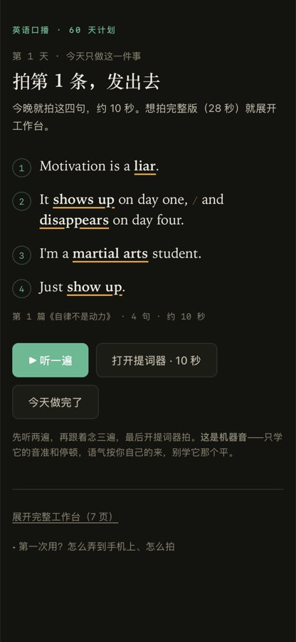
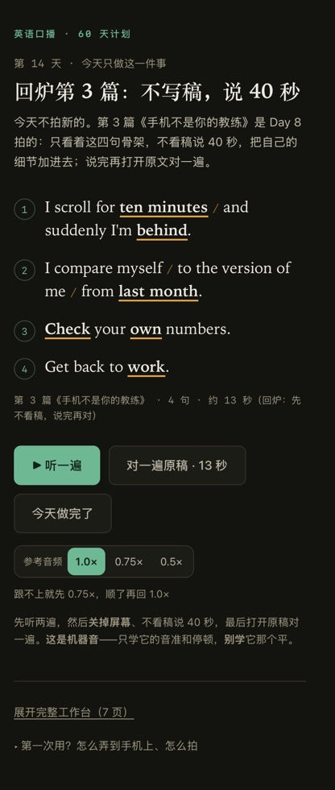
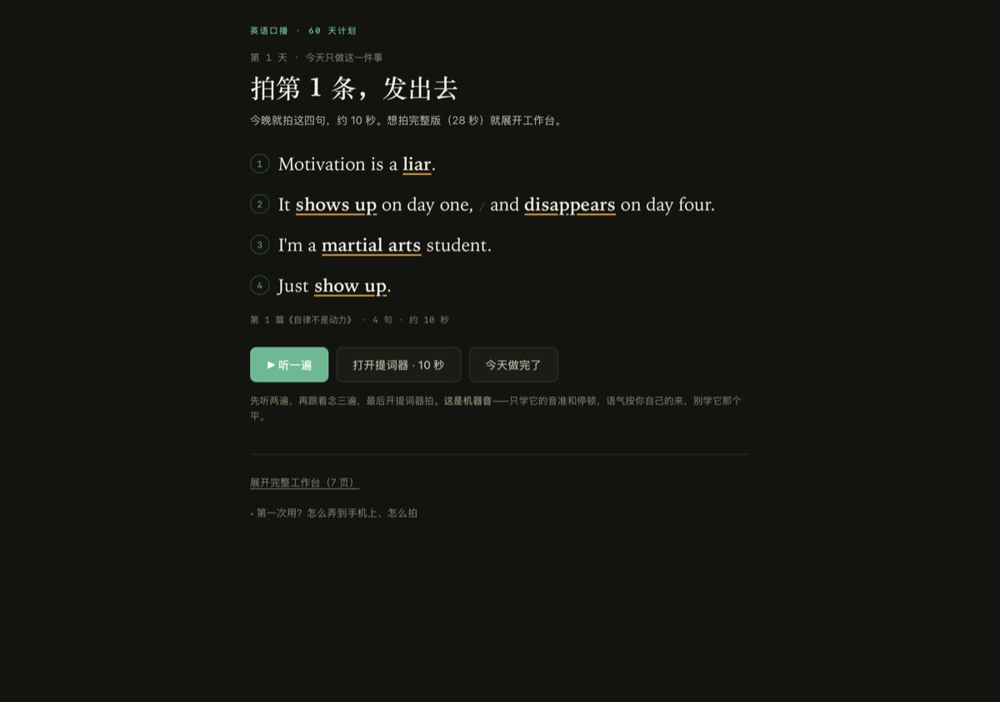
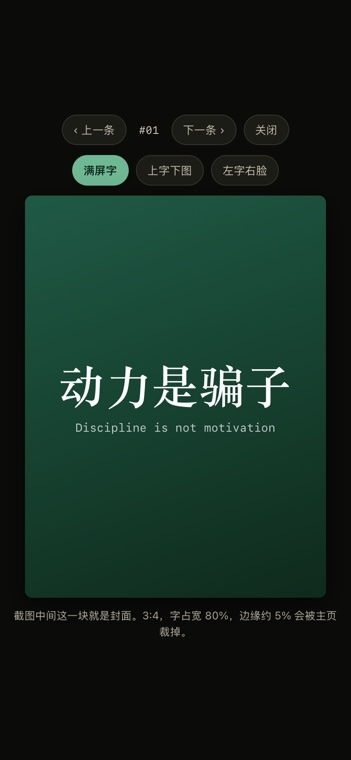
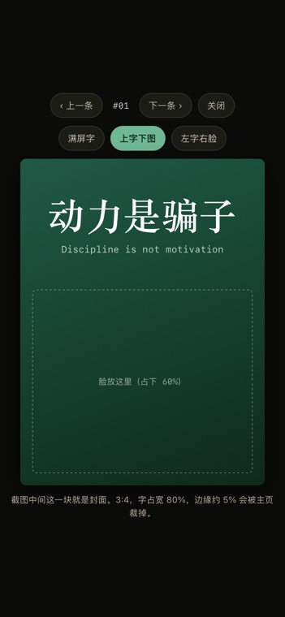
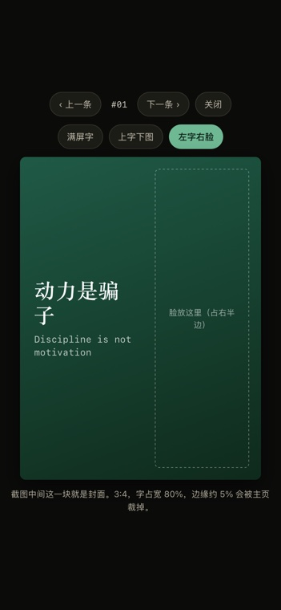
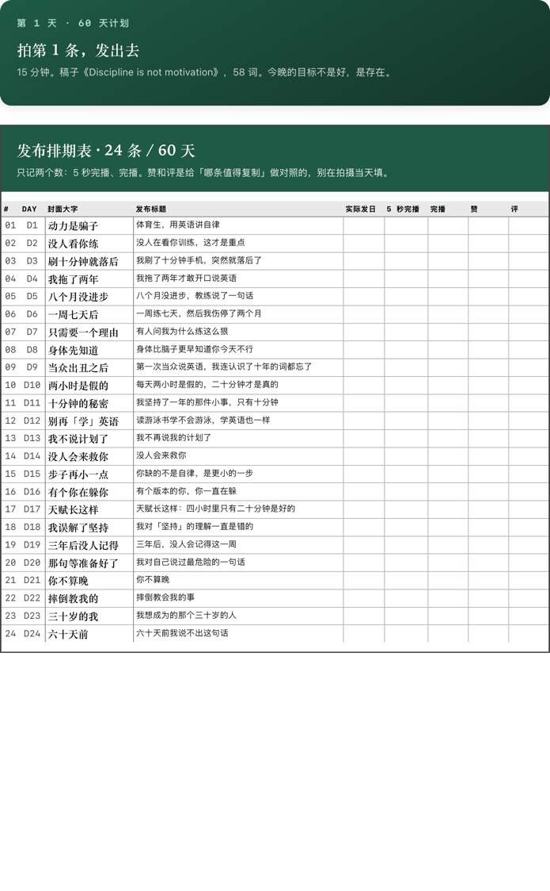

# 我的作品集 · ZAIN0214

> 成都体育学院 · 大一 · 体育生
> 用 AI 辅助学习与创作的一些小作品，全部单文件、双击即用、不联网。

🌐 **在线预览**：[zain0214.github.io/dsh-workspace](https://zain0214.github.io/dsh-workspace/)

---

## 📂 项目

### 🎤 英语口播工作台 · 体育生的 30 天
`english-oral-lab.html` · **[打开](https://zain0214.github.io/dsh-workspace/english-oral-lab.html)**

> 🚀 **只想马上拍一条？** 看 [口播-今晚就拍.md](口播-今晚就拍.md) —— 一页纸，不打开网页也能开拍。

### 从这里开始（两步）

1. 读 [口播-今晚就拍.md](口播-今晚就拍.md)（2.4KB，手机两屏）
2. 拍完第一条，再打开 [english-oral-lab.html](english-oral-lab.html) 接着走 60 天

> ✅ 已上线，手机上直接打开就能用（不用装 App）。已核对线上文件与本地逐字节一致。

### 打开长这样

第一次打开就是这一屏，不用注册、不用登录、不用往下翻。

第 14 天（回炉日）长这样：不拍新稿，只把第 3 篇不看稿说 40 秒

桌面宽屏长这样

封面放大层长这样（三张是同一套字，只换版式；点开就能截图）

  

发布排期表打印出来长这样（A4 一张，24 条）

### 这份东西的边界（我知道自己没验到什么）

这一轮换了台真引擎重验：用 PyObjC 起一个真 `WKWebView`（Safari / iOS 同一个引擎），把页面加载进去、执行 JS、逐个点按钮、逐个解码音频、截图。**所以下面「验过」那一列，不再只是静态快照。**

| 验过（真 WebKit 引擎里跑过一整个来回） | 还没验到 |
|---|---|
| 逻辑与数据一致性：jsdom 877 项断言全绿（其中 36 项专查「页面上的数字声称 ↔ 真数据」、9 项专查「拍摄提示/开场 hook/生词表 ↔ 稿子」、17 项专查「.srt 字幕 ↔ 稿子」、14 项专查「单机提词卡 ↔ 第 1 篇四句」、17 项专查「打卡状态 ↔ 存档」、16 项专查「诊断器的输入与结论」、13 项专查「回填数据的异常值」、4 项专查「打印速查卡 ↔ 稿子」、17 项专查「提词器行为」、11 项专查「单页复制四句」）+ 真引擎 200 项检查（66 项页面运行 + 19 项封面放大层 + 10 项打印版式 + 44 项多屏宽巡检 + 9 项字幕导出 + 7 项单机提词卡 + 6 项打卡状态 + 7 项诊断器 + 5 项回填异常值 + 14 项提词器与练习计时器 + 13 项复制四句；音频按你的要求不再跑机器测试） | 扬声器出声好不好听 → **你本人戴着耳机听过，说没问题**（我这边引擎测不了音量/音色，就不再做机器验收） |
| 24 篇音频在真引擎里**逐个解码成功**，时长与标注一致（9.9 / 10.4 / 13.0 …秒） | 提词器按真实秒数滚完（后台窗口定时器被节流到 1Hz，只验到每 tick 位移对） |
| 首访即单页模式；**5 种屏宽巡检（320 / 375 / 390 / 414 / 768）44 项全过**：没元素戳出屏幕、任务+四句+按钮+倍速都在第一屏、封面层 3:4 且控件全在屏内、主按钮 42–46px 高、倍速档 32px | 真正的分页（打印管线在测试环境里会无限分页，只验到版式） |
| 打卡状态跨刷新/切模式都记得住：打过卡就显示「已打卡 ✓（今天完成了）」并置灰，副文案自动换成「明天做什么」 | |
| 7 个 tab、筛选、展开、提词器、打卡逐个真点，全程零 JS 报错 | iOS Safari 真机上的具体表现（引擎同源，但没实机） |
| 打印版式：把 `@media print` 规则套到屏幕上渲染，白纸黑字、两栏 24 张速查卡、控件不印出来 | |
| 打印页数按 A4 实测（A4 可用宽 695px / 高 1024px）：**开拍卡 966px＝1 页、24 张速查卡 1958px＝2 页、发布排期表 667px＝1 页**，三个「打印这一页」各打各的、互不串页；打印时不再印「今日动作卡」 | |
| 对比度逐元素算 WCAG 比值（单页 + 7 个页、浅深两套主题各扫一遍）：**0 处低于 4.5:1**；填色主按钮 8.05:1（浅）/ 6.96:1（深）。深色主题原来白字压在浅绿上是 **2.34:1**，改成深色字；浅色主题的小号琥珀字是 3.22–3.35，压到了 4.5 以上 | |

右列那几条「还没验到」都是**测试环境**的限制（窗口不可见 / 定时器被节流 / 打印管线会无限分页 / 没有 iPhone），不是代码里已知的坑。**你用一次就全知道了。** 音频那条你已经用耳朵验收过，从这轮起不再跑机器测试。

打开就是**一页**：今天第几天、只做哪一件事、要说哪四句（带朗读音频和重读标记）、一个提词器按钮。别的都收在折叠区里，点「展开完整工作台」才出来。

**怎么用**：手机浏览器打开 <https://zain0214.github.io/dsh-workspace/english-oral-lab.html>，加到主屏幕当 App 用。拍摄时看电脑上打印的速查卡，不看手机。

做「英语口播 + 个人提升」抖音账号的作战台。练口语和做账号是同一件事的两面：

- **定位** → 体育生用英语讲自律，反差就是护城河；附账号装修、拍摄 SOP、发布话术
- **选题库** → 40 条按五个支柱分类，每条配一句能直接当开场白的英文；附「选题 → 稿子」10 分钟骨架、开场 5 公式、抽象词黑名单、词数算时长的计算器
- **极简版 + 参考音频** → 24 篇稿子每篇都附一个 4 句 / 十几秒的「今晚就能拍完」版本，**每一条都内置了朗读音频**（慢速、带停顿），**每句都标出了重读词**（加粗 + 下划线），先听两遍再跟读，然后开提词器拍；**参考音频可切 1.0× / 0.75× / 0.5×**，跟读跟不上就先降速；单页里就有一套，不用展开工作台，两处状态同步、选择会记住
- **双语字幕：复制 + .srt 文件** → 每篇都能一键复制「英文一行 + 中文一行」；也能直接下载**带时间轴的 .srt**（完整版和 4 句极简版各一份），剪映「文本 → 导入字幕」直接认，一句一条不用对轴——24 篇都验过：cue 数、逐句文字、时间戳顺序/不重叠、总时长都被断言盯着
- **24 篇口播稿** → 够拍 60 天。第 1 个月 12 条（A/B 级，Day 1–29）起号，第 2 个月 12 条（B 级定型 + C 级放大，Day 32–59）往上走；英文全文带停顿点、逐句中译、难词音标、拍摄提示，可按月份筛
- **回炉日（11 天）** → 60 天里有 11 天不拍新稿：把更早那篇**不写稿说 40 秒**，说完再打开原稿对一遍（第 4、9、14、19、24、31、36、41、46、51、56 天）。按顺序把第 1–11 篇各回炉一次——新稿让你敢拍，回炉才让嘴真的变熟
- **先测再拍** → 8 句分级自测，用手机听写数「认错几个词」，直接算出你该从哪一级、哪一篇开始
- **内置提词器** → 全屏大字、可调字号、自动滚动，架好手机就能拍
- **发音纠正** → 7 组中国人高频错音（θ/s、v/w、æ/e、r/l、iː/ɪ、连读、重音），最小对立词对 + 舌位要领
- **发音自测闭环** → 15 句诊断句，每句标出目标词的音标，用语音识别当考官：识别成什么，就说明哪里错了；配五遍修正法
- **错音本** → 把「以为说的是 / 识别成什么」记下来，自动统计**错 2 次以上的词**和**反复错的那一组音**；认得的最小对立词会自动挂上「第 N 组 /θ/ 和 /s/」，点一下就跳到那组训练（存在本地，最多留 200 条）
- **今日动作卡** → 设一次开始日期，首页每天直接告诉你「今天只做哪一件事」，一键跳到对应稿子或页面；单页上就有「**复制四句**」——只有一台手机时，粘进剪映提词器就能边看边拍（回炉日自动复制回炉那篇）
- **60 天路线** → 起号（1–30）/ 定型（31–45）/ 放大（46–60），每段都有定量准入标准，达不到不跳级；60 天 = 24 个拍摄日 + 11 个回炉日 + 21 个阅读日 + 4 个特殊日，每天只有一件事
- **数据诊断器** → 填入 5 秒完播、完整完播、点赞率、评论数（可选填视频时长）——**达标线按片长换**（15 秒 40%、60 秒 25%，中间线性插值），按严重程度排出最该改的几件事；填错格式会当场拦住（把 32% 填成 0.32 不会给出「严重偏低」这种反向结论），已经不到 20 秒的片子也不会被劝「砍到 20 秒」
- **60 天打卡 + 数据回填** → 自动算完播率与发音自评均值，**并按每条自己的片长判过没过线**，给出调整建议；填成 300 这种不可能的数不会拉高均值，而是点名「第 3 条填了 300」并暂时不参与统计（错音本也验过：认词 → 自动挂发音组 → 反复错的音汇总 → 点一下跳到那组训练）
- **出镜训练** → 六个参数（机位/距离/构图/眼神/第一口气/语速）+ 八个 60 秒练习（带计时器）+ 四种镜头与切镜原则
- **逐秒分镜** → 第 1 条视频切成 8 刀，每刀有时间码、景别、台词、怎么拍；附「一次拍摄备够三条」的素材清单
- **封面** → 3:4 规格、四条规矩、三种版式，24 条视频的封面文案（每个 4–8 字）；**点任意一张能放大到满屏 3:4，随时在「满屏字 / 上字下图 / 左字右脸」之间切，字按字数自动占到封面宽 76%，虚线框标出脸该站哪——截图那一块就是能直接发的封面**
- **发布排期表** → 一页 A4 管 60 天：24 行（Day / 封面大字 / 发布标题 / 实际发日 / 5 秒完播 / 完播 / 赞 / 评），前四列自动从数据填好，后五格留白给手写；单独「打印这一页」，不会把开拍卡和速查卡一起带出来
- **单机提词** → 只有一台手机、也没打印机时，用剪映自带的「提词拍摄 / 悬浮提词」：四步走完，提词器浮在相机画面上，眼睛不离开镜头；今晚那四句直接从数据填好，另给「打印 / 第二台设备 / 直接背」三个备选
- **开拍卡** → 一页纸、可打印：15 分钟流程、发布前 6 项检查、发完只记两个数
- **24 条速查卡** → 两栏排版、A4 两页打完，每条 4 句带重读下划线。手机在拍的时候，看的是这张纸

全部单文件、离线可用，打卡和数据存在浏览器里。

---

### 🐍 Python 零基础学习站
`python-learn.html` · **[打开](https://zain0214.github.io/dsh-workspace/python-learn.html)**

一个完整的自适应学习流程，不是题库合集：

- **摸底** → 10 题测出你在 4 个维度上的起点
- **诊断** → 生成专属的 6 节课学习路线
- **分步带学** → 18 张讲解卡，每张只讲一个概念，讲完立刻检查
- **提问区** → 每节课后列出「你可能会问的问题」，点开就有答案
- **小测 + 结课测验** → 即时判分、逐题解析、推荐该复习哪几节

每个知识点都配了「换个更简单的说法」按钮，用打印机、储物柜、存钱罐这类生活事物做类比。进度存在浏览器里，关掉再打开接着学。

---

### 📋 拾光计划 · 学习任务看板
`study-board.html` · **[打开](https://zain0214.github.io/dsh-workspace/study-board.html)**

把模糊的「我要好好学习」变成可以勾掉的任务。轻量、无依赖、纯本地。

---

### 🤖 怎么高效地指挥 AI
`高效指挥AI助手.html` · **[打开](https://zain0214.github.io/dsh-workspace/高效指挥AI助手.html)**

一份使用手册，讲清楚怎么给 AI 下指令才不浪费时间和钱：

- 高效请求的 5 个要素（目标 / 背景 / 约束 / 交付形式 / 验收标准）
- 四种协作模式，按任务大小选
- 出点子的正确姿势：**先要数量，别要质量**
- 6 个可直接复制的模板

网页版带侧边目录、滚动高亮、一键复制模板，支持打印成 PDF，暗色模式自动适配。

---

## 🛠 关于这个仓库

- 所有页面都是**单文件 HTML**，零依赖、离线可用
- 由 [DeepSeek Harness](https://github.com/deepseek-ai) 协助完成：我负责提需求、定方向、验收，AI 负责实现和迭代
- 记录了我从一个不会用 AI 的人，到能把 AI 当同事用的过程

## 📄 许可

个人学习用途，欢迎参考。如果这些页面对你有帮助，点个 ⭐ 就行。
